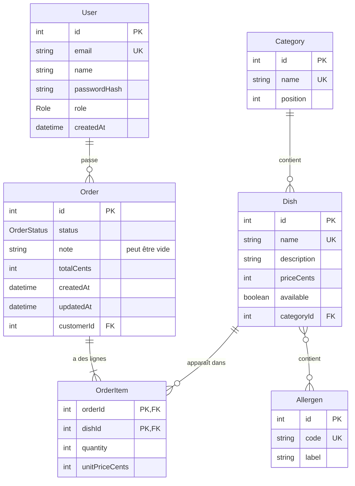

# La Roulotte : API de click & collect

L'API du food truck La Roulotte, projet de back du bachelor dev de Sup de Vinci. Les clients consultent la carte et passent commande, la cuisine voit les commandes arriver.

Node.js, TypeScript, Express 5, Zod, Prisma 7 avec SQLite, Vitest et Supertest pour les tests.

Le kit du prof est à la racine du dépôt (`contrat/`, `front/`, `recette/`, `pay-sim/`, `fourni/`) et on le modifie pas. Notre API est dans `api/`.

## Lancer l'API

Il faut Node 22 ou plus. Depuis la racine du dépôt :

```bash
cd api
npm install
cp .env.example .env
npm run setup
npm run dev
```

`npm run setup` génère le client Prisma, crée la base SQLite à partir des migrations, puis la remplit avec le seed (`donnees/menu.json`). L'API tourne ensuite sur http://localhost:3000.

Pour repartir d'une base propre, `npm run seed` suffit : il vide la base avant de la remplir.

Les comptes créés par le seed :

| Email | Mot de passe | Rôle |
|---|---|---|
| admin@roulotte.test | Admin123! | ADMIN |
| cuisine@roulotte.test | Cuisine123! | STAFF |
| client@roulotte.test | Client123! | CUSTOMER |

## Le front et la recette

Depuis la racine du dépôt, avec l'API lancée dans un autre terminal :

```bash
npm run front        # le front sur http://localhost:5173
npm run recette:1    # les tests automatiques du palier 1
```

## Les tests

Dans `api/` :

```bash
npm test             # Vitest, sans que l'API tourne et sans toucher à la base
npm run typecheck    # vérifie les types sans compiler
```

Les tests du service des commandes utilisent de faux repositories, par exemple :

- les prix viennent de la base, jamais du client (l'exemple de l'énoncé)
- un plat inconnu ou indisponible donne une 422 qui liste tous les plats refusés, et rien est créé
- un client qui lit la commande d'un autre client prend une 404
- la cuisine peut lire la commande d'un client
- un client liste que ses commandes, la cuisine les voit toutes

## Où on en est

Palier visé : 2. Au 27/11, `npm run recette:2` est entièrement vert (la recette 2 rejoue aussi la 1).

Ce qui marche :

- le schéma Prisma (2 migrations : `init` et `stock`), le seed (5 catégories, 14 allergènes, 16 plats avec leur stock, 3 comptes)
- l'authentification fournie, branchée sur un repository d'utilisateurs Prisma
- la carte en lecture (`/categories`, `/allergens`, `/dishes`) et son administration par l'admin (`POST`, `PATCH`, `DELETE /dishes`)
- les commandes : créer, lister, lire, et changer le statut (`PATCH /orders/:id/status`)
- le stock : retiré à la commande dans une transaction (tout ou rien, décrément conditionnel), remis en cas d'annulation
- la machine à états des commandes, écrite à un seul endroit (`orders.status.ts`)
- 24 tests (Vitest) : services avec de faux repositories, machine à états, carte via Supertest

Ce qui marche pas encore :

- les tests HTTP Supertest sur `/orders` et `/auth`
- le palier 3 (temps réel, photos, cache) et le palier 4 (paiement)

## Schéma de données



- 1-n : un client a plusieurs commandes, une catégorie a plusieurs plats.
- n-n implicite entre `Dish` et `Allergen` : Prisma crée tout seul la table de liaison `_AllergenToDish`.
- n-n explicite entre `Order` et `Dish` avec `OrderItem`. Sa clé composite `(orderId, dishId)` empêche d'avoir deux fois le même plat dans une commande.
- `unitPriceCents` garde le prix au moment de la commande. Si le prix du plat change après, les anciennes commandes bougent pas.
- Un plat déjà commandé peut pas être supprimé (`onDelete: Restrict` sur `OrderItem` → `Dish`). Supprimer une commande supprime ses lignes (`onDelete: Cascade`).
- Les montants sont en centimes, donc des entiers, pour éviter les erreurs d'arrondi.
- On stocke jamais le mot de passe, juste son hash bcrypt dans `passwordHash`.

## Architecture

Une requête passe par 4 couches : routes → controller → service → repository.

- les routes posent les protections (`requireAuth`) et appellent le controller
- le controller valide l'entrée avec Zod, appelle le service et répond avec le bon statut
- le service porte les règles métier, sans `req`/`res` et sans Prisma
- le repository est le seul à parler à la base

Par exemple pour `POST /orders` : `requireAuth` vérifie le token, le controller valide le corps avec `placeOrderSchema`, le service va chercher les plats en base, refuse les plats inconnus ou indisponibles (422) et calcule le total avec les prix de la base. Le repository Prisma crée la commande et ses lignes d'un coup, puis le controller répond 201 avec l'en-tête `Location` et le résultat de `toOrderDto`.

```
api/
  donnees/menu.json        le menu chargé par le seed
  prisma/
    schema.prisma          le modèle de données
    migrations/            l'historique du schéma
    seed.ts                vide la base puis la remplit
  src/
    db/prisma.ts           le client Prisma unique
    fourni/auth/           le module d'auth fourni, pas modifié
    shared/errors.ts       AppError, les erreurs prévues
    modules/orders/        le module commandes
    server.ts              démarre le serveur
```

## Les patterns et où ils sont

- Repository (DAO) → `src/modules/orders/orders.repository.ts` et `orders.prisma-repository.ts`. Le service doit calculer une commande sans savoir que la base c'est Prisma, et on veut pouvoir le tester sans base. Donc une interface `OrderRepository`, et une version Prisma qui est le seul fichier des commandes à importer Prisma.
- Singleton → `src/db/prisma.ts`. Un seul `PrismaClient` pour toute l'API, sinon chaque nouveau client ouvrirait ses propres connexions à la base.
- DTO → `orders.dto.ts`. Le client doit pas pouvoir envoyer ses propres prix ou des champs en plus, et une réponse doit pas montrer l'email ou le `passwordHash` du client. Donc des schémas Zod `strictObject` en entrée, et `toOrderDto` en sortie qui garde que les champs du contrat.
- Injection de dépendances, le D de SOLID → `orders.service.ts` et `orders.service.test.ts`. `OrderService` reçoit ses repositories dans son constructeur au lieu de les créer, donc dans les tests on lui passe des faux.
- Interface étroite, le I de SOLID → `DishReader` dans `orders.repository.ts`. Les commandes ont juste besoin de retrouver des plats par leurs ids, donc l'interface a une seule méthode, `findByIds`.
- Factory → `createOrderController` dans `orders.controller.ts` et `createOrderRouter` dans `orders.routes.ts`. Elles fabriquent le controller et le routeur avec ce dont ils ont besoin.

Le composition root (`container.ts`), l'Adapter qui branche notre repository d'utilisateurs sur `AuthUserStore` et la factory `createApp` arrivent avec la partie de Loulou733.

## Répartition du travail

- Victor Melwig-Maes : Prisma (schéma, migration, seed, client unique), le module commandes (DTO, repositories, service, controller, routes) et ses tests, le nettoyage du dépôt.
- Loulou733 : l'initialisation du projet (`package.json`, `tsconfig.json`), le socle (`server.ts`, `.env.example`, copie du module fourni et du menu) et `AppError`. À venir : config, app, container, gestionnaire d'erreurs, utilisateurs et carte.
